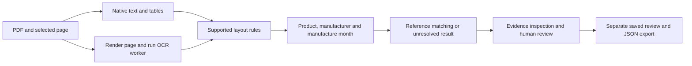

# Strata

**Bilingual document OCR and evidence-based material-reference review.**

Strata extracts text and material entries from PDFs, matches supplied product details against manufacturer references, and preserves the evidence for human review. The app supports native PDF text and tables, Japanese-English OCR for scanned item blocks, and a persistent review history.

The current prototype uses two curated Nichiha reference records. Decisions describe matching against those records for the supplied product, manufacturer and manufacturing month. Generic material names and insufficient evidence can remain unresolved.

## Run in the existing project environment

```bash
source .venv-ocr/bin/activate
python -m streamlit run streamlit_app.py --server.address 0.0.0.0 --server.port 8501 --server.headless true
```

In Codespaces, open forwarded port **8501**. The [five-minute demo guide](docs/demo.md) covers both pages and the review workflow.

## New Codespace: install

The captured live-OCR runtime is Linux x86-64, Python 3.11.17, Streamlit 1.66.1, Pillow 12.3.0, pdfplumber 0.11.9, EasyOCR 1.7.2, PyTorch 2.14.1+cpu and torchvision 0.29.1+cpu. Exact installed package versions and model hashes are recorded in [the environment snapshot](docs/environment_cpu.json).

Use these creation commands in a new workspace. Python bootstrap uses [uv's Python environment support](https://docs.astral.sh/uv/pip/environments/).

```bash
python -m venv .venv-tools
.venv-tools/bin/python -m pip install uv
.venv-tools/bin/uv venv --python 3.11.17 --seed .venv-ocr
source .venv-ocr/bin/activate
python -m pip install -r requirements.txt
python -m pip check
python setup_models.py
python check_demo.py
```

Model setup downloads the pretrained Japanese-English detector and recognizer when missing. Live OCR uses CPU; a GPU is optional. Application OCR runs in a separate process with a timeout, one CPU thread and bounded raster size.

For a smaller demo environment covering saved predictions, native PDFs and human review, create `.venv-demo` using the same Python version and install `requirements-demo.txt`. Live OCR additionally needs the full dependencies and model setup above.

The requirements files capture the working environment. A clean-install check is a separate verification step; preserve its actual output when validating another machine or environment.

## Bundled examples and data

The app verifies the examples against [the demo asset manifest](assets/demo/manifest.json):

| Example | Origin and purpose |
|---|---|
| Historical drawing crop | Real HABS drawing obtained through Wikimedia; used to inspect OCR material mentions |
| KMEW PDF | Real manufacturer certificate snapshot dated 2026-10-25; used for native text and table extraction |
| Scanned schedule | Clearly labelled synthetic image-only PDF; used to demonstrate OCR, matching and review |

The bundled examples work without `data/raw/` or `data/processed/`. Uploads are processed from their bytes. These ignored folders are used by earlier research scripts and optional regeneration steps.

Sources and hashes are retained in the manifest and report evidence. Third-party documents retain their source terms. KMEW table candidates remain pending review and have not been imported into the active reference catalogue.

## What happens to a document



Native extraction uses pdfplumber. Scanned-page OCR uses pretrained EasyOCR Japanese-English models. OCR detections retain raw text, confidence, raster coordinates and PDF coordinates. Label normalization handles compact labels such as `Manufacturemonth` while preserving the extracted values and source evidence.

Reference matching requires an exact supported product or alias, a matching manufacturer, and a valid manufacturing month within a unique reference period. Similar names are review suggestions. Sales dates and installation years do not become manufacturing dates.

Reviews retain the original result, submitted details, evidence note, reviewer name, catalogue hash and timestamp. Practice submissions are labelled as synthetic tests. History is stored in ignored workspace SQLite files under `data/reviews/`; reviewer names are self-reported.

## Recorded evaluation

| Evaluation | Recorded result | Scope |
|---|---|---|
| End-to-end scan stress suite | 10/12 status agreements; CER 5.42%; 0 incorrect resolved decisions | Four synthetic scenarios with three correlated scan variants each |
| Non-asbestos reference retrieval in that suite | Precision 1/1; recall 1/3 | Two expected non-asbestos results remained unresolved |
| Real historical drawing | Tesseract baseline and tiled OCR each recovered 3/8 selected target keywords; GPU EasyOCR recovered 2/8 | Selected development regions from one drawing crop |
| Japanese wall-table OCR | 11/21 names at original crop size; 21/21 with 2x input | Same table and recognizer, development comparison |
| Latin SOLIDO identifiers | 0/2 with Japanese-English recognition; 2/2 with English recognition | Two identifiers in one table, post-hoc comparison |

The stress suite exposed `0` to `o` date errors and `M` to `川` suffix errors in rotated labels. Those strings remained unchanged and affected reference matching as documented in the [error analysis](reports/validation_suite/error_analysis.md).

Detailed evidence is under:

- [Drawing OCR baseline](reports/ocr_baseline/README.md)
- [Manufacturer matching](reports/matching/README.md)
- [Japanese synthetic schedule](reports/schedule_extraction/README.md)
- [Real reference extraction](reports/reference_extraction/README.md)
- [Additional OCR comparisons](reports/reference_validation/README.md)
- [Native PDF review workflow](reports/pdf_workflow/README.md)
- [Scanned PDF integration](reports/scanned_pdf/README.md)
- [Synthetic stress suite](reports/validation_suite/README.md)

## Checks and experiment replay

```bash
python -m unittest discover -v
python check_demo.py
```

The unit suite contains **50 tests**, collected from [`tests/`](tests/). The
repository-layout verification and the actual test output are recorded in
[`docs/verification/README.md`](docs/verification/README.md). These software checks
are separate from the OCR-quality measurements above.

Recorded cleanup run:

```text
Ran 50 tests in 0.592s

OK
```

`check_demo.py` copies the application and bundled examples into a temporary snapshot with no raw data, processed data, model cache or review history. It checks the saved-review and native-PDF pages, verifies 39 native example entries, and checks that the scanned example has no selectable text. It does not run live OCR.

To check live OCR separately after model setup:

```bash
python -u ocr_worker.py --pdf reports/scanned_pdf/evidence/synthetic_schedule_scan.pdf --page 1 --output data/processed/repro_scan.json
```

The existing stress-suite inputs, predictions and metrics are frozen in
`reports/validation_suite/`. The experiment entry point is now
`python -m experiments.validate_pipeline --help`; see the
[experiment guide](experiments/README.md) before running it. Its source-fingerprint
check intentionally rejects archived results from a different code layout. Do not
edit old fingerprints to make them pass. Inspect the archived evidence directly,
or use its recorded historical checkout for an exact replay. Keep new experiments
separate from those frozen results.

## Project map

| Files | Responsibility |
|---|---|
| `streamlit_app.py`, `app_pages/` | Navigation and user interface |
| `demo_assets.py`, `assets/demo/` | Bundled-example integrity and provenance |
| `pdf_processing.py`, `pdf_ocr.py`, `ocr_layout.py`, `ocr_worker.py` | Native extraction, shared line reconstruction, raster/OCR evidence and isolated execution |
| `extract_schedule.py`, `extract_reference_candidates.py`, `pdf_candidates.py` | Supported field and table extraction rules |
| `material_matcher.py`, `material_review.py` | Exact reference decisions and review suggestions |
| `pdf_review.py`, `review_history.py` | Review identity, evidence and SQLite persistence |
| [`tests/`](tests/) | Unit checks; discover with `python -m unittest discover -v` |
| [`experiments/`](experiments/) | Earlier drawing, table and scan-evaluation research; run as modules |
| [`scripts/`](scripts/) | Author-side asset preparation and checkpoint capture |
| `reports/`, `docs/verification/` | Frozen research evidence and recorded software verification |

The root keeps the application modules and the everyday launch/check commands.
Earlier experiments live under `experiments/`; this keeps their optional model,
GPU and raw-data requirements separate from the demo. The shared OCR line-layout
helper is in `ocr_layout.py`, so the app does not import an experiment runner.
`python -m scripts.package_demo` is the author-side capture helper; ordinary fresh
setups use the bundled assets. The [layout guide](docs/repository_layout.md) maps the
old script locations to the new commands, including Kaggle usage.

## Current limits

The active catalogue is small. Native-table parsing is document-specific. The scanned-page path extracts labelled item blocks; it does not reconstruct scanned tables or automatically connect arbitrary drawing symbols to materials. Independent real-document validation, broader reference coverage and model fine-tuning remain extensions. All OCR experiments here use pretrained models.

Database reference matching provides evidence for document review. It does not establish the physical composition of an installed material. Workspace SQLite history has no authentication or tamper-proof audit controls.
